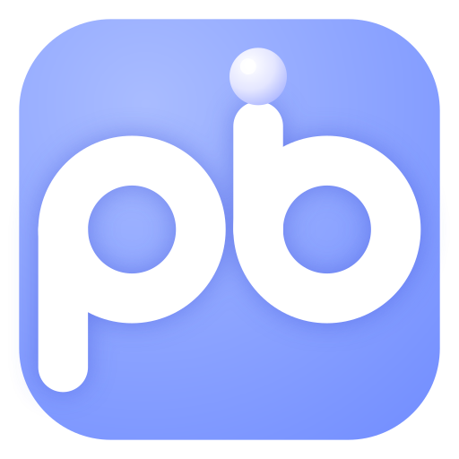

  

<h1 align="center">Pibot</h1>

여행 전에는 일정을 짜 주고, 여행 중에 계획이 틀어지면 고쳐 주고, 일정 사이 빈 시간은 채워 주는 여행 AI 에이전트.

## 팀원

<table align="center">
  <tr>
    <td align="center"></td>
    <td align="center"></td>
  </tr>
  <tr>
    <td align="center"><a href="https://github.com/Gwakgarin">곽가린</a></td>
    <td align="center"><a href="https://github.com/sonyeseul63">손예슬</a></td>
  </tr>
  <tr>
    <td align="center"><b>AI · 디자인</b></td>
    <td align="center"><b>백엔드 · 프론트</b></td>
  </tr>
  <tr>
    <td align="center">
      일정 생성·재계획 에이전트 
      RAG 장소 검색·평가 
      일정 검증 로직 
      UI/UX 설계, 로고
    </td>
    <td align="center">
      API·DB 설계 및 구현 
      길찾기·날씨·주차 도구 
      Expo 앱 화면 개발 
      서버 구축 및 배포
    </td>
  </tr>
</table>
